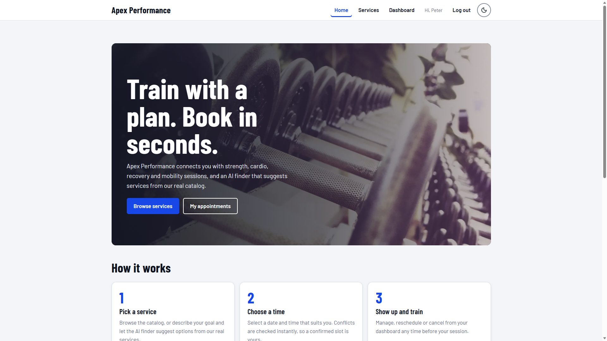
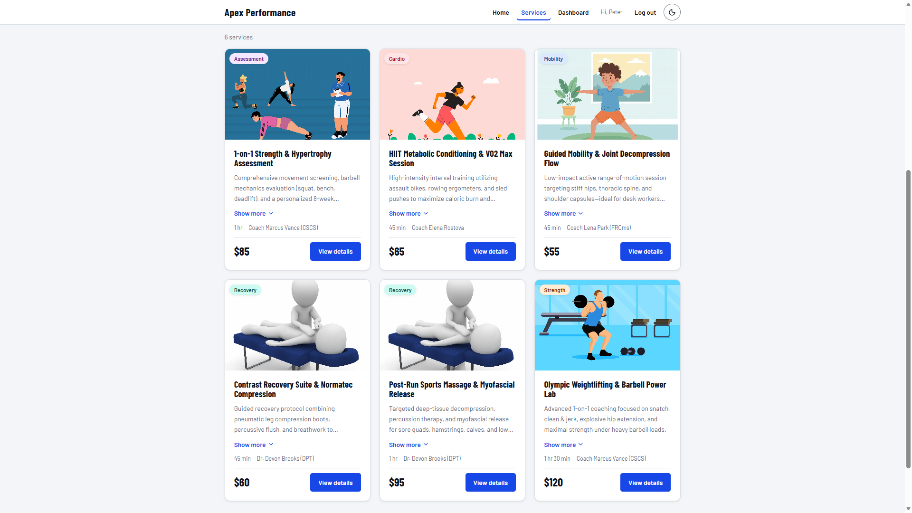
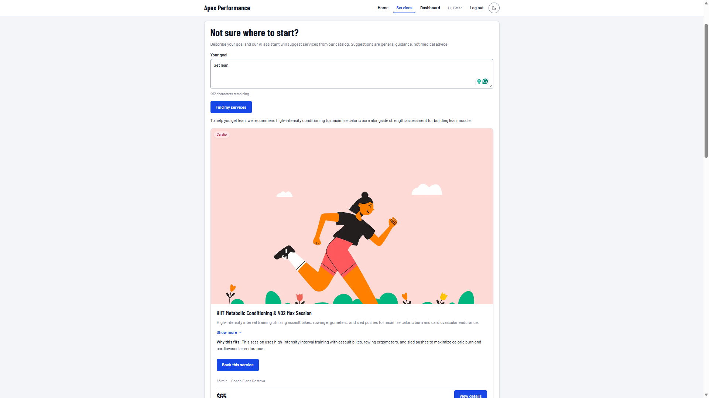
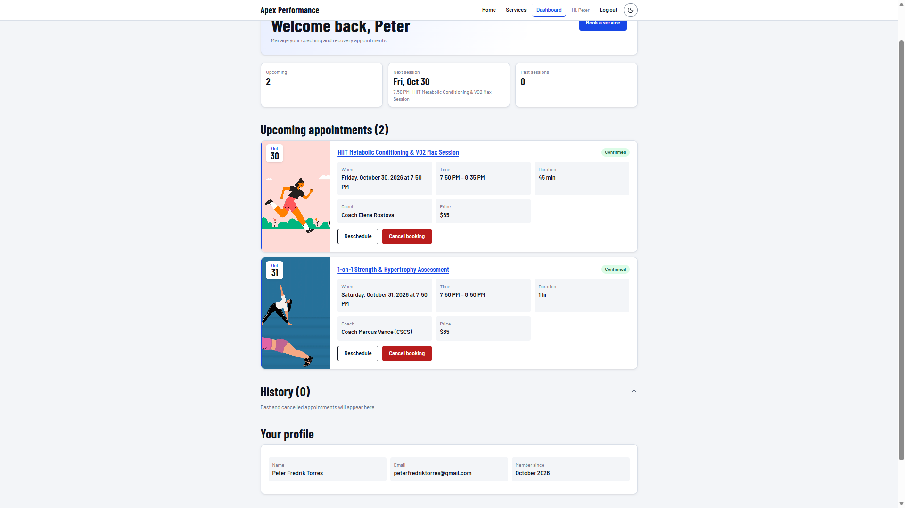
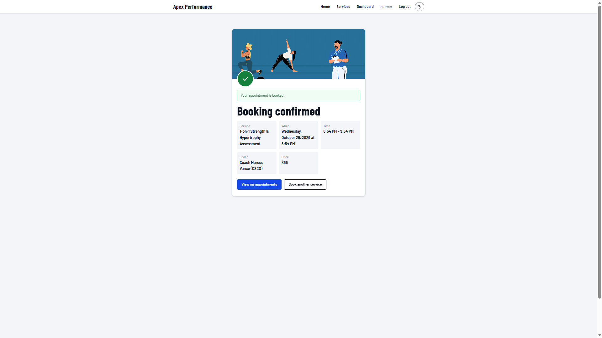

# Apex Performance

**An AI-assisted booking platform for fitness coaching and athletic recovery sessions.**

Apex Performance is built for busy professionals, amateur athletes, and beginners who want structured 1-on-1 coaching or recovery sessions but struggle to know which training, mobility, or recovery session fits their current fitness level, schedule, and soreness or injury constraints.

| | |
|---|---|
| **Live site** | https://apex-performance-bookings.vercel.app |
| **Live API** | https://apex-performance-xqfe.onrender.com/api (health check: `/api/health`) |
| **Repository** | https://github.com/petertorres232-byte/booking-capstone |
| **Author** | Peter Torres |
| **SDLC report** | [Formal documentation report (PDF)](docs/Apex-Performance-SDLC-Report.pdf) |

> **Note on the free hosting tier:** the API runs on Render's free plan and sleeps after 15 minutes without traffic. The first request after a quiet period can take around a minute to wake it. Later requests are fast.



---

## Table of contents

1. [Overview](#overview)
2. [Screenshots](#screenshots)
3. [Key features](#key-features)
4. [AI-powered feature](#ai-powered-feature)
5. [Tech stack](#tech-stack)
6. [Architecture](#architecture)
7. [Project structure](#project-structure)
8. [Setup and running locally](#setup-and-running-locally)
9. [Environment variables](#environment-variables)
10. [REST API reference](#rest-api-reference)
11. [Security measures](#security-measures)
12. [Testing and verification](#testing-and-verification)
13. [Deployment](#deployment)
14. [Known limitations](#known-limitations)
15. [How AI was used during development](#how-ai-was-used-during-development)
16. [Credits](#credits)

---

## Overview

This is a full-stack capstone project: a three-tier web application where users can register, browse a catalog of coaching and recovery services, ask an AI assistant which service fits their goal, book an appointment, and manage their bookings from a personal dashboard.

**Problem:** gym-goers and athletes often do not know which specialised session suits their fitness level, schedule, and soreness.
**Solution:** a clear service catalog, a safe booking flow with conflict detection, and an AI matchmaker that recommends only real services from the studio's own database.

## Screenshots

| Services catalog | AI service finder |
|---|---|
|  |  |

| Personal dashboard | Booking confirmation |
|---|---|
|  |  |

## Key features

**Accounts and security**
- Register, log in, and log out. Passwords are hashed with bcrypt (10 salt rounds).
- Sessions use signed JWTs that expire after 7 days. Protected pages and API routes reject anyone who is not logged in.
- Login failures return one generic message ("Invalid email or password"), so attackers cannot tell which emails have accounts.

**Service catalog**
- Browse active services with category, duration, price, coach, and description. Filter by category without reloading the page.
- A detail page for each service with a "Book" call to action. The category tiles on the home page link straight to filtered results.

**Booking management (full CRUD)**
- Create a booking with a future date and time and optional notes. The server calculates the end time and rejects overlapping bookings for the same service (HTTP 409).
- View upcoming sessions and history on the dashboard, with colour-coded status badges (confirmed, completed, cancelled, past).
- Reschedule or edit notes on an upcoming booking, and cancel it (a soft cancel that keeps history). Both actions use confirmation dialogs and update immediately.
- Each booking stores a snapshot of the price and duration at booking time, so later catalog changes never rewrite history.

**Dashboard**
- Welcome header, summary strip (upcoming count, next session, past sessions), booking cards with images, collapsible history, and a profile section (name, email, member since).

**Design and accessibility**
- Responsive layout (mobile, tablet, desktop), light and dark themes (follows the system setting, with a manual toggle that is remembered), animated booking confirmation, and reduced-motion support.
- Keyboard-friendly dialogs and forms, visible focus states, and accessible labels and status messages.

## AI-powered feature

**Smart Training Matchmaker** (on the Services page). The user describes a goal in plain English, for example *"my legs are sore after a long run and I want to recover faster"*. The app responds with up to three matching sessions, each with a short reason, and a **Book this service** button that takes them straight to the booking form for that exact service.

How it stays grounded in real data (no invented services):

1. The request goes to the Express server (`POST /api/ai/recommend-service`). The Gemini API key lives only in the server environment and never reaches the browser.
2. The server validates and cleans the text (5 to 500 characters, control characters and angle brackets removed).
3. The server loads all **active services from MongoDB** and puts them into the model's trusted system instructions. The user's text is passed separately inside `<user_request>` tags and is treated as data, not instructions.
4. Gemini is asked for structured JSON. The `serviceId` field is restricted to an enum of real database IDs.
5. The server **re-validates every returned ID** against the database, drops duplicates and unknown IDs, and builds the response from database records. Only the short "reason" text comes from the AI.
6. Out-of-scope, nonsense, or medical questions return an empty result with a polite message. Every response carries a "not medical advice" disclaimer.
7. If the AI provider is slow or down, the API returns a safe error plus a fallback hint, and the UI offers the normal catalog instead.

A 10-case evaluation set (ordinary, vague, irrelevant, prompt-injection, nonexistent-service, and medical requests) passed 10 of 10. See [Testing and verification](#testing-and-verification).

## Tech stack

| Layer | Technology |
|---|---|
| Frontend | React 19, Vite 8, React Router 7, Context API, plain CSS design tokens, Lucide icons, self-hosted Barlow fonts (`@fontsource`) |
| Backend | Node.js (18+), Express 4, ES modules |
| Database | MongoDB Atlas with Mongoose 8 |
| Auth and security | bcryptjs, jsonwebtoken, helmet, express-rate-limit, cors |
| AI | Google Gemini via the `@google/genai` SDK (model set by `AI_MODEL`), server-side only |
| Hosting | Vercel (client), Render (API), MongoDB Atlas (database) |

## Architecture

```text
+--------------------------------------------------------------+
| TIER 1: PRESENTATION  (browser, untrusted)                   |
| React + Vite on Vercel                                       |
| Pages -> components -> services/api.js (adds the JWT header) |
+------------------------------+-------------------------------+
                               | HTTPS JSON (CORS: one origin, rate limited)
                               v
+--------------------------------------------------------------+
| TIER 2: APPLICATION  (trusted gatekeeper)                    |
| Node + Express on Render                                     |
| helmet -> cors -> rate limit -> routes -> auth middleware    |
| -> controllers (validation, ownership) -> services (AI)      |
+---------------+----------------------------+-----------------+
                | Mongoose (TLS)             | HTTPS (server-side key)
                v                            v
+-----------------------------+   +-------------------------------+
| TIER 3A: DATA               |   | TIER 3B: AI ENGINE            |
| MongoDB Atlas               |   | Google Gemini API             |
| users, services, bookings   |   | gets goal + real catalog,     |
|                             |   | returns structured JSON       |
+-----------------------------+   +-------------------------------+
```

**Why the browser never talks to MongoDB or the AI directly:** the database credentials and the AI key are secrets, and anything in browser code is public. The server is the only place that can hold secrets, check who the user is, and enforce rules.

**Data model**

```text
USER 1 ----< BOOKING >---- 1 SERVICE
```

- `users`: name, email (unique, lowercase), `passwordHash` (never returned by queries), role (`client` or `admin`).
- `services`: name (unique), category (Strength, Cardio, Recovery, Mobility, Assessment), description, duration, price, coach, `isActive` soft-delete flag.
- `bookings`: user and service references, start and end time, status (`confirmed`, `completed`, `cancelled`), price and duration snapshots, notes. Compound indexes support fast conflict checks and the dashboard query.

## Project structure

```text
booking-capstone/
├── README.md
├── .gitignore
├── docs/                       SDLC report (PDF), image credits, screenshots
├── client/                     React + Vite frontend
│   ├── public/                 favicon, images, robots.txt
│   ├── vercel.json             SPA rewrite and security headers
│   └── src/
│       ├── components/         Navbar, ServiceCard, BookingCard, AIRecommender, dialogs...
│       ├── context/            AuthContext (session state)
│       ├── pages/              Home, Services, ServiceDetail, BookService, Dashboard, Login, Register
│       ├── services/api.js     central API client (base URL, JWT header, error parsing)
│       ├── styles/             page and component CSS
│       └── utils/              helpers (theme, images, formatting, safe redirects)
└── server/                     Node + Express backend
    ├── scripts/                seed, smoke test, AI evaluation, test-data cleanup
    └── src/
        ├── config/             MongoDB connection
        ├── controllers/        request validation and business rules
        ├── middleware/         auth, error handling, rate limiting
        ├── models/             Mongoose schemas
        ├── routes/             URL to controller mapping
        ├── services/           Gemini client and grounded recommendation logic
        └── server.js           app setup and middleware order
```

## Setup and running locally

**Prerequisites:** Node.js 18 or newer, a free [MongoDB Atlas](https://www.mongodb.com/atlas) cluster, and a [Google Gemini API key](https://aistudio.google.com/) (only needed for the AI feature).

```bash
git clone https://github.com/petertorres232-byte/booking-capstone.git
cd booking-capstone
```

### Run the backend

```bash
cd server
npm install
cp .env.example .env      # then edit .env with your real values (see below)
npm run seed              # loads the 6 sample services (safe to re-run)
npm run dev               # API on http://localhost:5000
```

Check it: open http://localhost:5000/api/health. It should report `"connected": true`.

### Run the frontend

In a second terminal:

```bash
cd client
npm install
cp .env.example .env      # defaults to http://localhost:5000/api
npm run dev               # app on http://localhost:5173
```

The backend only accepts requests from the origin in `CLIENT_ORIGIN` (default `http://localhost:5173`), so use that port.

### Useful commands

| Where | Command | Purpose |
|---|---|---|
| `client` | `npm run build` | Production build |
| `client` | `npm run preview` | Serve the production build locally |
| `client` | `npm run lint` | ESLint |
| `server` | `npm start` | Start without auto-reload (used in production) |
| `server` | `node scripts/smokeTest.js [--with-ai] [--base=URL]` | End-to-end API smoke test |
| `server` | `node scripts/evaluateAI.js` | 10-case AI safety and quality evaluation |
| `server` | `node scripts/cleanupTestData.js` | Report (and optionally remove) test users and bookings |

## Environment variables

Real values live only in `.env` files, which are git-ignored. Only the `.env.example` templates are committed.

**`server/.env`**

| Variable | Purpose |
|---|---|
| `PORT` | Port the API listens on (Render sets this automatically) |
| `NODE_ENV` | `development` or `production` (production enables proxy trust and requires `CLIENT_ORIGIN`) |
| `MONGODB_URI` | Atlas connection string, including the `/apex_performance` database name |
| `JWT_SECRET` | Long random string used to sign tokens |
| `JWT_EXPIRES_IN` | Token lifetime (default `7d`) |
| `CLIENT_ORIGIN` | The one frontend origin allowed by CORS, e.g. `https://apex-performance-bookings.vercel.app` (no trailing slash) |
| `AI_API_KEY` | Gemini API key (server only) |
| `AI_MODEL` | Gemini model name |
| `AI_TIMEOUT_MS` | Provider timeout in milliseconds (default `30000`) |

**`client/.env`**

| Variable | Purpose |
|---|---|
| `VITE_API_BASE_URL` | API base URL, e.g. `http://localhost:5000/api`. Public: Vite bakes it into the bundle, so never put a secret here. Changing it requires a rebuild or redeploy. |

## REST API reference

Base URL: `/api`. All bodies are JSON. Errors use `{ "status": "error", "statusCode": n, "message": "..." }`.

| Method | Path | Auth | Purpose | Notable errors |
|---|---|---|---|---|
| GET | `/health` | Public | Server and database status | 503 if the database is down |
| POST | `/auth/register` | Public | Create account, returns token and user | 400 invalid input, 409 duplicate email |
| POST | `/auth/login` | Public | Log in, returns token and user | 401 generic "Invalid email or password" |
| GET | `/auth/me` | Bearer token | Current user profile | 401 missing, invalid, or expired token |
| GET | `/services` | Public | Active services, optional `?category=` | 400 unknown category |
| GET | `/services/:id` | Public | One active service | 400 bad id, 404 not found |
| POST | `/ai/recommend-service` | Public (strict rate limit) | Grounded recommendations from `{ "message": "..." }` | 400 invalid text, 429 rate limited, 502/503/504 AI unavailable (with fallback hint) |
| POST | `/bookings` | Bearer token | Create booking from `{ serviceId, startTime, notes }` | 400 past or invalid, 404 inactive service, 409 overlap |
| GET | `/bookings/mine` | Bearer token | The caller's bookings only | 401 |
| PATCH | `/bookings/:id` | Bearer token, owner | Reschedule and/or edit notes | 400 not confirmed, 403 not the owner, 404, 409 overlap |
| DELETE | `/bookings/:id` | Bearer token, owner | Cancel (soft cancel, status becomes `cancelled`) | 400 already cancelled, 403, 404 |

## Security measures

- **Secrets:** none in client code or in git. The database URI, JWT secret, and AI key exist only as server environment variables. The server refuses to start in production without `CLIENT_ORIGIN`.
- **Passwords:** bcrypt hashes; the hash field is excluded from queries by default and from every API response.
- **Authentication and authorization:** JWT verification middleware on protected routes. Booking ownership is checked on every update and cancel. The booking owner always comes from the verified token, never from the request body.
- **Input validation:** server-side type and format checks on every endpoint. Object-shaped input (for example `{"$ne": null}`) is rejected before it can reach a database query, which defends against NoSQL injection. Request bodies are capped at 10 KB.
- **Headers and CORS:** `helmet` on the API. CORS allows exactly one origin. The Vercel config adds `X-Content-Type-Options`, `X-Frame-Options`, `Referrer-Policy`, and `Permissions-Policy`.
- **Rate limiting (per IP, per 15 minutes):** 100 requests for the general API, 15 for login and register, 10 for the AI endpoint.
- **AI safety:** the user's text is isolated and treated as data, model output is re-validated against the database, and responses include a medical disclaimer. AI text is rendered as plain text only.
- **Errors:** a global error handler returns safe messages. Provider and database details are logged on the server only.
- **Dependencies:** `npm audit` reported 0 vulnerabilities for both apps at the time of the final audit.

## Testing and verification

| Check | Result |
|---|---|
| API smoke test (register, login, protected routes, services, booking create, conflict, reschedule, cancel, ownership, injection and invalid-input negatives) | 40 checks pass locally and against the live API; 44 with the AI checks (`--with-ai`) |
| AI evaluation (ordinary, vague, irrelevant, prompt-injection, nonexistent service, medical) | 10 of 10 pass; results saved in `server/scripts/ai-evaluation-results.json`; vague, injection, and medical cases were also reviewed by hand |
| Lighthouse, production build, mobile profile | Performance 92 (Home), 97 (Services), 98 (Register), 95 (Book), 94 (Dashboard); Accessibility 100 and Best Practices 100 on all pages; layout shift 0 |
| SEO | 100 on public pages. Book and Dashboard score lower on purpose: they are private pages that `robots.txt` excludes from search engines |
| Lint and build | `npm run lint` and `npm run build` pass |
| Security audit | `npm audit` shows 0 vulnerabilities; the git history and working tree were scanned for committed secrets and found clean |
| Manual end-to-end | register, browse, AI recommend, book, dashboard, reschedule, cancel, logout, tested on the live deployment |

To reproduce: run the smoke test with `--base=https://apex-performance-xqfe.onrender.com/api`, or follow the local setup above. Run Lighthouse against `npm run build` plus `npm run preview`, not the dev server, because the dev server is unminified and gives misleading scores.

Full test evidence, including the defects found by testing and how each was fixed, is in section 9 of the [SDLC report](docs/Apex-Performance-SDLC-Report.pdf).

## Deployment

| Part | Platform | Configuration |
|---|---|---|
| Database | MongoDB Atlas (free tier) | Dedicated app user with read and write access to the app database only |
| API | Render web service | Root directory `server`, build `npm install`, start `npm start`, all `server/.env` variables set in the dashboard |
| Client | Vercel | Root directory `client`, framework Vite, `VITE_API_BASE_URL` set to the Render API URL ending in `/api`; `vercel.json` rewrites all paths to `index.html` so React Router deep links work on refresh |

Deployment order: database first, then the API, then the client, then set the API's `CLIENT_ORIGIN` to the final client URL and redeploy it. Both Render and Vercel redeploy automatically when `main` is pushed.

## Known limitations

These are documented deliberately. They are design trade-offs of a free-tier capstone, not hidden bugs.

- **Cold starts:** Render's free plan sleeps after 15 minutes idle; the first request can take around a minute.
- **Booking rules:** conflict detection is per service, so one user can hold two overlapping bookings for different services. Business hours and coach availability are not modelled.
- **Admin:** an `admin` role exists in the model and in the ownership checks, but there is no admin interface.
- **Token storage:** the JWT is kept in `localStorage`, which is simple but readable by injected scripts if an XSS flaw ever existed. React escapes output and there is no raw-HTML rendering, which lowers that risk.
- **Rate limiters** are in memory, so they reset on restart and are not shared across multiple servers.
- **No strict Content-Security-Policy** on the client; the inline theme script would need a hash to allow one.
- **Shared database:** local development and production use the same Atlas database, and Atlas network access is open to all IPs because Render's free plan has no fixed address. The free Atlas tier has no automated backups.
- **AI results** are not kept when the user navigates away from the Services page, and a "book" choice made before logging in is not carried through the login redirect.
- **Automated tests:** verification is by smoke-test and evaluation scripts plus manual testing; there is no unit-test suite.

## How AI was used during development

AI was used as a development assistant under my direction, and I tested every step before moving on.

- **Planning and design:** Google Gemini and Claude helped brainstorm the domain, draft user stories and acceptance criteria, design the three-tier architecture and ASCII wireframes, and produce the database contract and seed plan.
- **Implementation:** Claude acted as a step-by-step mentor and pair programmer, working from a master prompt that required one file per step, complete code, negative tests, a security check, and a Git checkpoint with every step. It helped write the backend, the React client, the grounded AI service, the design system, and the deployment configuration.
- **Debugging and hardening:** AI helped diagnose issues (CORS during preview, layout shift, theme flash, environment variable mix-ups) and run security and quality audits.
- **Documentation:** AI helped draft this README and the formal report. Every step has a log entry in the [SDLC report](docs/Apex-Performance-SDLC-Report.pdf).
- **In the product:** Google Gemini powers the Smart Training Matchmaker described above. It is grounded in the live database and its output is validated before display.

**My responsibility:** I ran and verified each step, reviewed and understood the code, made the final technical decisions (for example soft-cancelling bookings, keeping the AI key server-side, and accepting the free-tier limitations listed above), and tested the deployed app. The complete AI usage log is in the [SDLC documentation report](docs/Apex-Performance-SDLC-Report.pdf).

## Credits

Images, fonts, and icons are credited in [`docs/IMAGE_CREDITS.md`](docs/IMAGE_CREDITS.md): illustrations and the hero photo from Pixabay (Pixabay Content License), Barlow fonts (SIL Open Font License), and Lucide icons (ISC).